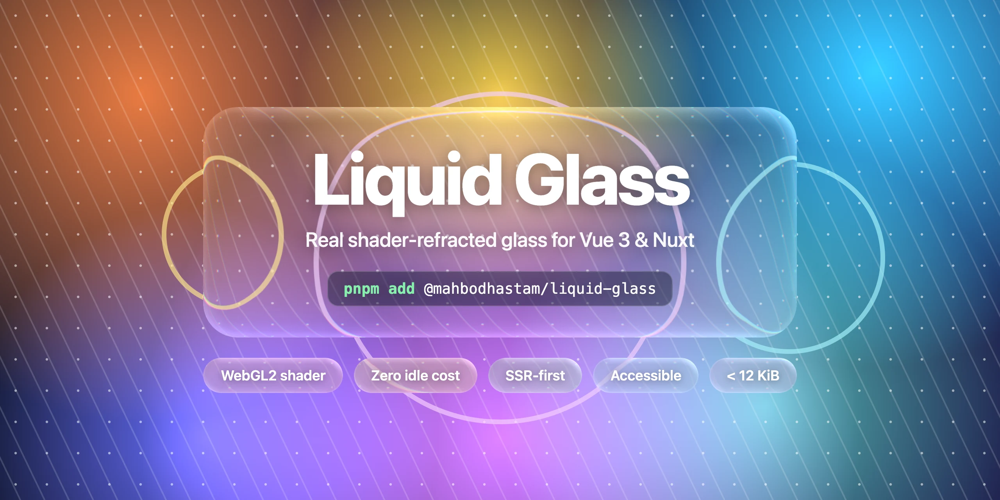

<h1 align="center">
  
</h1>

<p align="center">
  <a href="https://www.npmjs.com/package/@mahbodhastam/liquid-glass"></a>
  <a href="https://www.npmjs.com/package/@mahbodhastam/liquid-glass"></a>
  <a href="https://bundlephobia.com/package/@mahbodhastam/liquid-glass"></a>
  <a href="https://github.com/MahbodHastam/liquid-glass/actions/workflows/ci.yml"></a>
  <a href="https://github.com/MahbodHastam/liquid-glass/stargazers"></a>
  <a href="https://github.com/MahbodHastam/liquid-glass/blob/main/LICENSE"></a>
</p>

Liquid glass for Vue 3 and Nuxt, rendered with WebGL2 shaders. It does real
refraction, lens distortion, chromatic aberration, frost and edge lighting. It runs in Chrome,
Edge, Firefox and Safari.

- **Real shader.** Each lens is masked by a signed distance field and has a quarter-circle
  bevel profile. It is not an SVG displacement filter, so Safari and Firefox get the same effect.
- **Costs nothing at idle.** Frames render on demand and the page uses one shared WebGL
  context. Scrolling over a backdrop is a uniform update, not a re-upload.
- **Accessible by default.** It respects `prefers-reduced-motion`, `prefers-reduced-transparency`,
  `prefers-contrast`, `forced-colors` and Save-Data with no configuration.
- **SSR-first.** The server renders a CSS `backdrop-filter` fallback. The client adds the WebGL
  canvas after mount. Hydration has no warnings and needs no `<ClientOnly>`.
- **Small.** The main entry is under 12 KiB min+gzip. snapDOM, the DOM-capture library, is
  optional and loads only when a snapshot backdrop needs it.

## Install

```sh
pnpm add @mahbodhastam/liquid-glass
# only if you want glass over arbitrary HTML (see "Backdrops"):
pnpm add @zumer/snapdom
```

It requires Vue 3.4 or newer and is tested on Vue 3.4 and 3.5. It supports Nuxt 3.13 or newer,
including Nuxt 4.

## Vue

```ts
// main.ts
import { createLiquidGlass } from '@mahbodhastam/liquid-glass'

app.use(createLiquidGlass({
  // optional: enables <LiquidGlassBackdrop> (glass over arbitrary DOM)
  capture: () => import('@mahbodhastam/liquid-glass/snapdom'),
}))
```

```vue
<script setup lang="ts">
import { ref } from 'vue'

const hero = ref<HTMLImageElement | null>(null)
</script>

<template>
  <section class="relative">
    
    <LiquidGlass :source="hero" class="rounded-3xl p-6" :blur="12" :refraction="0.4">
      <h2>Content stays real DOM</h2>
    </LiquidGlass>
  </section>
</template>
```

No plugin is needed if you import the components directly:
`import { LiquidGlass, LiquidGlassBackdrop } from '@mahbodhastam/liquid-glass'`.

## Nuxt

```ts
// nuxt.config.ts
export default defineNuxtConfig({
  modules: ['@mahbodhastam/liquid-glass/nuxt'],
  liquidGlass: {
    prefix: '', // for example, 'U' gives <ULiquidGlass>
    quality: 'auto',
    maxDpr: 1.5,
    defaults: { blur: 12 },
    snapshot: 'auto', // wires snapDOM automatically when @zumer/snapdom is installed
  },
})
```

The module auto-imports `<LiquidGlass>`, `<LiquidGlassBackdrop>`, `useLiquidGlass` and
`useLiquidGlassPreferences`. It is tested with `ssr: true` and `nuxt generate`.

## Backdrops

WebGL can't read the pixels behind a canvas, so each lens needs a source to refract.

| Source | Use it for | Cost |
|---|---|---|
| Media: `:source="imgRef"` (``, `<video>`, `<canvas>`) | Heroes, cards over photos, video backgrounds | Near zero. No DOM capture. Video updates once per video frame. Honours `object-fit` / `object-position`. |
| Snapshot: wrap content in `<LiquidGlassBackdrop>` | Glass over arbitrary HTML, such as a sticky navbar over page content | One capture on mount, then again on resize, font load, image load or `refresh()`. Scrolling never re-captures. |

```vue
<LiquidGlassBackdrop>
  <LiquidGlass class="sticky top-2 h-14 rounded-2xl">Nav</LiquidGlass>
  <article>…page content…</article>
</LiquidGlassBackdrop>
```

`<LiquidGlassBackdrop>` props:

| Prop | Default | |
|---|---|---|
| `observe` | `false` | Re-captures when the DOM inside changes. Debounced. |
| `captureScale` | `0.5` | Capture resolution. The blur hides the downscale. Raise it toward `1` when lenses zoom or refract text. |
| `embedFonts` | `false` | Embeds web fonts in the capture. Slower, especially in Safari. |
| `ignoreSaveData` | `false` | Captures even when the user has Save-Data on. |
| `capture` | plugin config | Overrides the capture loader. |

It exposes `refresh()`.

**Snapshot limitations.** snapDOM rasterises the DOM through an SVG `foreignObject`, so the
capture is never pixel-perfect. It can't see iframes, cross-origin images served without CORS,
or some CSS features. Content that changes all the time, such as a carousel or a counter, needs
`observe` or a manual `refresh()`. The GPU limits texture size, so the library captures very
tall containers at a lower scale. Use the media source whenever the backdrop is an image or
video.

Cross-origin media must be CORS-enabled. Set `crossorigin="anonymous"` on the element and serve
the file with an `Access-Control-Allow-Origin` header. Otherwise that lens falls back to CSS and
logs one warning in dev mode.

## `<LiquidGlass>` props

| Prop | Type | Default | |
|---|---|---|---|
| `as` | `string` | `'div'` | Root tag |
| `radius` | `number \| 'auto'` | `'auto'` | `'auto'` reads the computed `border-radius`, so Tailwind `rounded-*` works |
| `blur` | px | `12` | |
| `refraction` | 0 to 1 | `0.3` | Rim displacement |
| `zoom` | 1 or more | `1.1` | |
| `aberration` | 0 to 1 | `0.2` | `0` compiles out two texture taps |
| `frost` | 0 to 1 | `0.08` | Static grain |
| `light` | 0 to 1 | `0.3` | Specular rim |
| `lightAngle` | deg | `-55` | |
| `edgeGlow`, `edgeWidth` | 0 to 1 | `0.4`, `0.25` | |
| `tint` | CSS colour | `'transparent'` | Mixed in by its alpha |
| `opacity` | 0 to 1 | `1` | |
| `source` | element | none | Media backdrop |
| `interactive` | `boolean` | `false` | Highlight follows the pointer. Off under reduced motion. |
| `quality` | `'auto' \| 'high' \| 'medium' \| 'low' \| 'off'` | `'auto'` | |
| `reducedMotion` | `'auto' \| 'static' \| 'fallback' \| 'ignore'` | `'auto'` | See [Accessibility](#accessibility) |
| `disabled` | `boolean` | `false` | Forces the CSS fallback |

Events: `ready`, `fallback(reason)`, `contextlost`, `contextrestored`.
Exposed: `refresh()`, `relayout()`, `isWebGL`, `quality`.

The element is re-measured after every Vue re-render and on scroll/resize. If you move it some
other way (a CSS animation, or direct style writes), call `relayout()`. It costs one
`getBoundingClientRect` on the next frame.

## Composables

```ts
// headless: put glass on any element
const el = ref<HTMLElement | null>(null)
const { isWebGL, reason, quality, refresh, relayout } = useLiquidGlass(el, () => ({
  source: img.value,
  blur: 10,
}))

// reactive user preferences (SSR-safe: defaults until mounted)
const { reducedMotion, reducedTransparency, moreContrast, forcedColors, saveData } = useLiquidGlassPreferences()
```

## Accessibility

These work with no configuration and react to runtime changes:

| User preference | Behaviour |
|---|---|
| `prefers-reduced-motion: reduce` | Still glass, but refraction drops to 35%, zoom drops to 1, no pointer tracking. No animation loop ever runs. |
| `reducedMotion="fallback"` with reduced motion on | CSS fallback instead |
| `reducedMotion="static"` | Always behave as reduced |
| `reducedMotion="ignore"` | Opts out. Not recommended. |
| `prefers-reduced-transparency: reduce` | Opaque surface, never glass |
| `prefers-contrast: more`, `forced-colors: active` | Opaque `Canvas`/`CanvasText` surface with a visible border, never glass |
| Save-Data | `auto` quality starts at `low`. Snapshot backdrops aren't captured, and snapDOM isn't downloaded, unless `ignoreSaveData` is set. |

The canvas is decorative: `aria-hidden="true"`, `pointer-events: none`, not focusable. Slot
content stays real DOM, so it is selectable and focusable and screen readers read it.

**Legibility is your responsibility.** Glass over an arbitrary backdrop can't guarantee
contrast. For body text, give the tint enough opacity that text meets WCAG AA (4.5:1) against
the worst case behind it. For example, white text on `tint="rgb(15 23 42 / 0.55)"` or dark
text on `tint="rgb(255 255 255 / 0.7)"`. Check with a contrast tool against your real
backdrop.

## Performance

- One WebGL2 context per page, created on first mount and released when the last lens
  unmounts.
- Frames render on demand only. Idle means zero `requestAnimationFrame` calls and zero GL
  calls; e2e tests verify this.
- The blur is a dual Kawase filter. It runs once per backdrop change, and the result is cached.
  The glass pass reads 1 to 3 texture taps per pixel.
- Off-screen lenses and background tabs don't render.
- The device pixel ratio is capped at 1.5 by default. Lower quality tiers reduce the pixel
  ratio, blur passes, aberration and frost. `auto` picks a starting tier from device hints. It
  steps down after sustained slow frames and never steps back up.
- On WebGL context loss, lenses fall back to CSS. They recover when the browser restores the
  context.

Measured numbers and methods are in [docs/perf.md](docs/perf.md). Real-device mobile numbers
are still pending.

## Browser support

WebGL2 works in Chrome, Edge, Firefox and Safari 15 or newer, on desktop and iOS. The e2e
suite runs on Chromium, Firefox and WebKit. Where WebGL2 isn't available, the CSS `backdrop-filter` fallback
stays in place.

## Development

```sh
pnpm install
pnpm build          # tsdown builds dist: index, core, snapdom, nuxt
pnpm dev            # Vite playground (build first; it imports dist)
pnpm dev:nuxt       # Nuxt SSR fixture
pnpm test           # unit (Vitest + happy-dom)
pnpm test:e2e       # real WebGL: Chromium, Firefox, WebKit, Nuxt SSR
pnpm size           # 12 KiB min+gzip budget
pnpm bench          # presentation benchmark (docs/perf.md)
```

## License

MIT
